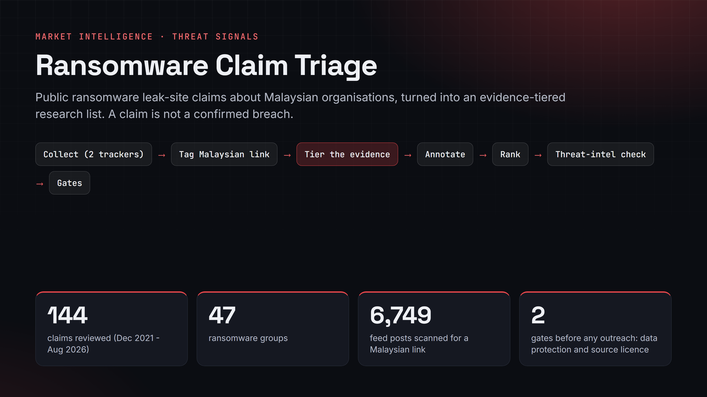

# Ransomware Claim Triage

A research method that turns public ransomware leak-site claims about Malaysian organisations into an
evidence-tiered prospect list for a managed-security provider. The core rule: **a claim is not a confirmed breach**,
so every row says how strong its evidence is, and nothing is filled in by guesswork.

## Method
1. **Collect** claims from two public ransomware-tracking services and cross-check them. For 2026, 33 claims were in
   both, 15 only in the first and 6 only in the second, so neither source was enough on its own.
2. **Find the Malaysian link** when a feed has no country field: STRONG (.my domain, "Sdn Bhd", "Berhad" or
   "Malaysia" in the name), MEDIUM (Malaysian place or institution words), WEAK (Malaysia only in the description).
   6,749 feed posts scanned, 53 candidates (34 strong, 5 medium, 14 weak).
3. **Tier the evidence:** A = confirmed by the organisation or an authority (5), C = leak-site claim only (144),
   X = disputed or stale (7). Tier B was left for the threat-intel team to fill.
4. **Annotate, never infer:** entity resolution (71 clear Malaysian companies, 39 domain only, 14 public sector,
   10 global brands, 10 ambiguous), 21 repeat listings, claimant groups known to be unreliable, mislabelled sectors.
5. **Rank** with a points score built only from signals the tracker shows: domain published, proof posted,
   infostealer exposure flagged, a known vulnerability, a recent claim. Public-sector rows are excluded.
6. **Validate** with the threat-intel team before anything else happens.
7. **Gates before any outreach:** a data-protection (PDPA) review and written approval from the data source for
   commercial use. Outreach would never mention the incident. The project paused at validation, and no organisation
   was contacted.

## What it never contains
No leaked data (none was downloaded; only a yes/no "proof posted" flag was kept), no contacts, and no organisation
names on this page.

## Claims by sector
Dec 2021 - Aug 2026, sectors as labelled by the tracker, 144 claims, 47 ransomware groups:

Manufacturing 22 · Transportation 18 · Technology 17 · Professional services 14 · Government 13 ·
Agriculture and food 11 · Retail 10 · Hospitality 8 · Healthcare 8 · Financial 8 · Energy 5 · Education 4 · Other 6

**Tools:** Python (requests, regular expressions, openpyxl), public ransomware-tracker data, Excel · built with Claude
Code as a coding assistant
